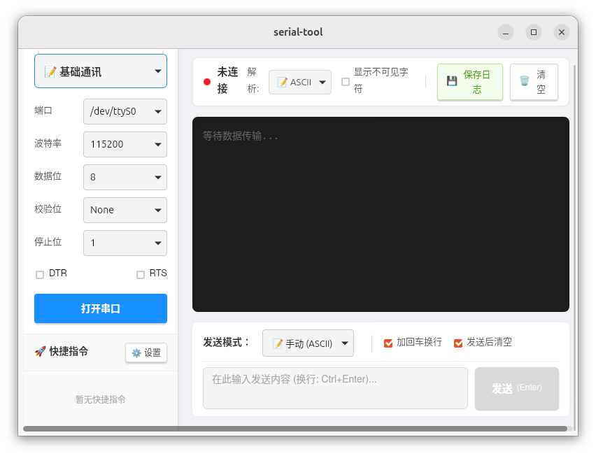

> ## [The development team of none](https://blog.codeberg.org/protecting-our-floss-commons-from-llms.html)
> Using LLMs to work with your code gives you a kick of adrenaline. You can develop at a rapid pace, build things as if you had a large team. Only that you have none. In fact, you are (often) alone, working with a statistical machine that turns energy into code.
>
>  It seems like many ‘vibe coders’ don't realize that they don't actually have a community around them. They build projects as if they had, and spend resources accordingly. We see projects having a lot of code activity, heavy CI/CD testing, frequent and large release binaries. Sometimes, it feels like the amount of supported platforms exceeds the amount of actual users.
>
> To us, it seems ridiculous to see projects with a single developer and virtually no users consuming as much or even more resources than some of the largest community projects on Codeberg, which operate frugal with CI/CD and storage resources. We do not believe it is reasonable for Codeberg to invest our precious donation money into hosting of large ghost projects.

前几天看到这段话，深以为然  
ai的出现给我好像一种无所不能的感觉。但实际上，每一步都需要跟着ai走，出错了也不会自己调。  
就像是许愿一样，新型的赌博，拿时间和金钱  
况且就算写好了，谁能保证ai写的就没有漏洞，没有后门 而且，版权究竟归谁呢  
所以我觉得，ai应该只是辅助，不应该像这个项目（姑且这么称呼）一样交给他全权处置  
如果你在找串口工具的话，Windows上有[MobaXterm](https://mobaxterm.mobatek.net/),ubuntu上有picocom/minicom或者screen等，都可以apt一句命令下载  
其他操作系统我不太清楚（/好想要个mac/），但是总归会有不错的工具的  
当然承认ai真的强，好多方面都有帮助

# 🔌 Serial Port Tool

一个基于 **Tauri + React + Rust** 的串口调试工具。  
由 Gemini Pro 辅助开发（初次尝试项目，欢迎找茬🐧）

## ✨ 功能特性

- 📡 串口扫描与连接
- 📤 数据发送（支持文本 / HEX / 文件发送/定时发送）
- 📥 数据接收（实时显示）
- 🧾 数据日志记录
- ⚙️ 波特率 / 数据位 / 校验位 / 停止位配置
- ✨跨平台支持（Windows / Linux / macOS）

## 📌 TODO

- [ ] 📊 串口数据波形显示（示波器功能）
- [ ] 🤖 编程式发送（脚本/自动化发送）
- [ ] 🛰️GNSS可视化工具
- [ ] 🎨 UI 优化
- [ ] 🧩 模块化架构重构

## 🖼️ 界面预览

